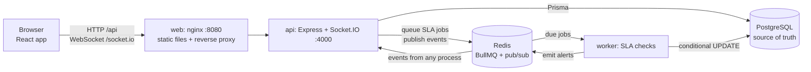

# SliqDesk

A small multi-tenant support desk: organizations, members with roles, tickets, comments, live
updates and SLA alerts. Node.js (Express) API, React frontend and a background worker, started
with one `docker compose up`.

## Contents

- [SliqDesk](#sliqdesk)
  - [Contents](#contents)
  - [Setup](#setup)
    - [Seeded logins](#seeded-logins)
    - [Local development without Docker for the app](#local-development-without-docker-for-the-app)
    - [Triggering an SLA alert](#triggering-an-sla-alert)
    - [Checks](#checks)
  - [Architecture](#architecture)
  - [Key decisions](#key-decisions)
    - [Tenant isolation](#tenant-isolation)
    - [Data model](#data-model)
    - [Authentication and sessions](#authentication-and-sessions)
    - [Permissions](#permissions)
    - [Real-time updates](#real-time-updates)
    - [Background processing: SLA alerts](#background-processing-sla-alerts)
    - [API design and errors](#api-design-and-errors)
    - [Frontend](#frontend)
    - [Testing](#testing)
  - [API](#api)
  - [Implementation status](#implementation-status)
  - [Assumptions](#assumptions)
  - [Next steps](#next-steps)
  - [AI usage](#ai-usage)

## Setup

From a fresh clone, with Docker running:

```bash
docker compose up --build
```

Then open **<http://localhost:8080>** and log in with one of the seeded accounts below.

This starts Postgres, Redis, the API (applies migrations and seeds demo data on start), the SLA
worker and the web app (nginx serving the React build and forwarding `/api` and `/socket.io` to
the API). No `.env` is needed; every setting has a working default (see `.env.example` to
override). The API is also reachable directly on <http://localhost:4000>.

To see live updates, open the app in two browser windows (for example a normal and a private
window) logged in as different members of the same organization.

To start over with an empty database: `docker compose down -v`.

### Seeded logins

Password for every account: **`password123`**

| Organization | Admin               | Agent               | Viewer               |
| ------------ | ------------------- | ------------------- | -------------------- |
| Acme Support | `admin@acme.test`   | `agent@acme.test`   | `viewer@acme.test`   |
| Globex Help  | `admin@globex.test` | `agent@globex.test` | `viewer@globex.test` |

Each organization has a few tickets in different states. Acme's "Duplicate invoice emails" is
already overdue, and "Checkout page returns 500" becomes overdue about two minutes after start-up,
so an SLA alert appears without doing anything.

### Local development without Docker for the app

Requires Node 22+ and Docker (for Postgres and Redis). Stop the `api` and `worker` containers
first if they are running, since they use the same port.

```bash
npm install                                  # installs all workspaces, builds shared, generates Prisma client
docker compose up -d postgres redis          # database + Redis
cp .env.example apps/api/.env                # local configuration (working defaults)
npm run db:deploy -w @sliqdesk/api           # apply database migrations
npm run db:seed:dev -w @sliqdesk/api         # demo data (safe to repeat)
npm run dev                                  # shared + API + worker + web in one terminal
```

Open <http://localhost:5173>. Every save reloads what changed: the API and worker restart, the
web app hot-reloads, and edits to `packages/shared` are recompiled and picked up by both. A
change to `schema.prisma` also needs `npx prisma migrate dev --name <change>` in `apps/api`.

### Triggering an SLA alert

1. The SLA window is `SLA_MINUTES` (default `2`). For a faster demo start with
   `SLA_MINUTES=0.5 docker compose up` (30 seconds), or set it in a `.env` file.
2. As an Admin or Agent, create a ticket with priority **high** or **urgent**.
3. Don't comment on it as an Admin or Agent. When the time is up, the ticket is flagged
   overdue and every member of the organization gets a live alert.

A staff comment before the deadline, resolving or closing the ticket, or lowering its priority
stops the clock.

### Checks

```bash
npm test                   # unit tests (no database needed)
npm run test:integration   # API tests against Postgres (needs `docker compose up -d postgres`)
npm run lint               # ESLint
npm run format:check       # Prettier
npm run typecheck          # TypeScript
```

**CI:** GitHub Actions (`.github/workflows/ci.yml`) runs all of the above on every push and pull
request, with integration tests against a Postgres service container. A second job starts the
stack with `docker compose up --build --wait` from a clean checkout and smoke-tests it through
nginx (health check, seeded login, ticket list, web page), so the one-command setup is verified
on every push.

## Architecture



| Component           | Role                                                                                                                                                                                      |
| ------------------- | ----------------------------------------------------------------------------------------------------------------------------------------------------------------------------------------- |
| **web** (nginx)     | Serves the built React app and proxies `/api` and `/socket.io` to the API, so the browser sees one origin: the session cookie just works and no CORS is needed.                           |
| **api** (Express)   | REST API and Socket.IO on the same port. Authenticates every request from the session cookie, enforces permissions and tenant scoping, writes to Postgres, emits events, queues SLA jobs. |
| **worker**          | Same codebase and image as the API, different entry point (`worker.ts`). Runs SLA checks from the Redis queue plus a periodic sweep, and publishes alerts through Redis.                  |
| **PostgreSQL**      | All business data. Tenant isolation is also enforced here with composite foreign keys.                                                                                                    |
| **Redis**           | BullMQ delayed jobs (persisted with AOF) and Socket.IO pub/sub, which lets the worker and any number of API instances reach every connected browser.                                      |
| **packages/shared** | Roles, statuses, transitions, permission checks, Zod request schemas, DTO and event types. The API enforces these rules; the UI uses the same functions to decide which controls to show. |

**A request, end to end:** the browser sends `PATCH /api/tickets/:id` with its httpOnly cookie →
nginx forwards it → the API verifies the JWT and reloads the user (role, organization) → Zod
validates the body → the service loads the ticket scoped to the user's organization, checks the
permission and transition rules, and writes with an optimistic-concurrency check → after the
write it emits `ticket.updated` to that organization's Socket.IO room → every open browser of
that organization updates its cache and re-renders.

**Repository layout** (npm workspaces):

```text
packages/shared   Domain rules and types shared by API and web
apps/api          Express API, Socket.IO, Prisma schema and migrations, SLA worker, seed, tests
apps/web          React frontend (Vite) and its nginx config
docs/             Postman collection
```

## Key decisions

| Area                  | Choice                                                                          | Main trade-off                                                      |
| --------------------- | ------------------------------------------------------------------------------- | ------------------------------------------------------------------- |
| Language              | TypeScript everywhere, one shared package for rules and types                   | A build step and workspace tooling                                  |
| Database              | PostgreSQL + Prisma                                                             | Prisma hides some SQL; raw SQL where needed (row locks)             |
| Tenant isolation      | Shared tables, `organizationId` from the session, scoped queries, composite FKs | Relies on discipline plus tests; no Row-Level Security yet          |
| Auth                  | JWT in an httpOnly cookie with `tokenVersion`, user reloaded on every request   | One DB lookup per request; logout ends all of a user's sessions     |
| Real time             | Socket.IO, one room per organization, Redis adapter                             | Heavier client than SSE; events are not replayed after a disconnect |
| Background processing | BullMQ delayed job per deadline, separate worker, periodic sweep                | Redis is one more service to run                                    |
| Frontend              | Vite + React + React Query, served by nginx                                     | Plain styling (the brief judges correctness)                        |

### Tenant isolation

Every organization's data lives in shared tables, separated by an `organizationId` column, with
three layers of protection:

1. **The organization always comes from the session.** `organizationId` is taken from the
   authenticated user loaded on the server, never from the URL or body. Create requests ignore
   unknown fields and update requests reject them (`400`), so a client can't move data between
   organizations.
2. **Every query is scoped.** Records are loaded through helpers that filter by `id` **and**
   `organizationId` (`findTicketOrThrow`, `findActiveMember`). Another organization's record is
   simply not found: **`404`, not `403`**, so its existence isn't revealed.
3. **The database enforces it too.** Tickets and comments use composite foreign keys
   `(userId, organizationId) → users(id, organizationId)` and
   `(ticketId, organizationId) → tickets(id, organizationId)`, so Postgres rejects a ticket
   assigned to another organization's user, or a comment on another organization's ticket, even
   if application code had a bug.

Real-time events follow the same rule: sockets join only their own organization's room, chosen
by the server. Integration tests attack each area from a second organization (tickets, comments,
members, assignment, SLA jobs, sockets).

**Why not Row-Level Security or a database per tenant?** RLS is a strong second net, but with
Prisma it needs a transaction per request to set the tenant; it's the first hardening step I'd
add. A database per tenant gives physical isolation but makes migrations and connections heavy;
it fits a few very large or regulated tenants, not this scope.

### Data model

`organizations` → `users` (role, `tokenVersion`, `removedAt`) → `tickets` (status, priority,
assignee, SLA fields) → `comments`. UUID primary keys (not guessable), enums for role, status and
priority enforced by Postgres, timestamps stored in UTC.

- **Indexes match the queries:** `(organizationId, createdAt)`, plus
  `(organizationId, status|priority|assigneeId, createdAt)` for the filtered, newest-first list.
- **Soft-deleted members** (`removedAt`): history keeps their name, and `ON DELETE RESTRICT`
  stops Postgres from hard-deleting a user who authored tickets or comments.
- **SLA state lives on the ticket** (`slaDueAt`, `firstResponseAt`, `slaBreachedAt`), so the
  database, not the queue, is the source of truth.
- **Why Postgres over MongoDB:** the data is relational, and foreign keys, transactions and
  conditional updates give isolation and race-safety at the database level.

### Authentication and sessions

- **Login** sets an **httpOnly, `SameSite=Lax`** cookie (`Secure` when `COOKIE_SECURE=true`, for HTTPS deployments) holding a JWT
  (HS256, 7-day expiry) with only the user id and their `tokenVersion`. No role or organization
  in the token.
- **Every request reloads the user** from the database: a removed user, or a token whose
  `tokenVersion` no longer matches, gets `401`. Role changes and removals therefore apply on the
  very next request.
- **Logout increments `tokenVersion`**, revoking every copy of the token server-side, and closes
  the user's live sockets. Removing a member does the same.
- **The same cookie authenticates the Socket.IO handshake**, through the same `resolveSession`
  function.
- **Passwords** are hashed with bcrypt (cost 10). Login answers wrong-password and unknown-email
  identically, and runs bcrypt against a dummy hash for unknown emails, so neither the message
  nor the timing reveals which emails have accounts.
- **CSRF:** `SameSite=Lax` cookies aren't sent on cross-site POSTs, and the API only accepts JSON
  bodies, which plain HTML forms can't send. JWT verification pins the algorithm, rejecting
  `alg: none` tokens.
- **Trade-offs:** one database lookup per request (cacheable in Redis at scale), and logout ends
  all of a user's sessions. Per-device logout would mean server-side sessions in Redis.

### Permissions

The permissions table is implemented once, in `packages/shared` (`canCreateTicket`,
`canComment`, `canUpdateTicket`, `canManageMembers`, `STATUS_TRANSITIONS`). The API checks these
on every request; the UI uses the same functions only to decide what to show.

- **Ticket updates** go through a pure, unit-tested function: closed tickets can't change
  (`409`), Agents only change tickets assigned to them or unassigned (`403`), unchanged fields
  are ignored, and status moves must follow the transition table (`422`).
- **Optimistic concurrency:** the update applies only if the ticket's `updatedAt` hasn't changed
  since it was read, so two Agents claiming the same ticket can't both win (`409`).
- **Members:** an organization always keeps an Admin. Member changes lock the organization row
  (`SELECT … FOR UPDATE`), so two Admins demoting each other at once can't remove the last one.
  Removing a member, or demoting them to Viewer, unassigns their open tickets.

### Real-time updates

- Socket.IO runs inside the API on `/socket.io`. The browser's session cookie is sent with the
  WebSocket handshake and checked with the same `resolveSession` as REST requests.
- The server, not the client, decides subscriptions: each socket joins only `org:<its org>` and
  `user:<its id>`. Services emit after a successful database write, always to one org room, so
  a client has no way to receive another organization's events.
- Events: `ticket.created`, `ticket.updated`, `ticket.sla_breached`, `comment.created`,
  `members.changed`. Payloads carry the full ticket or comment.
- Logout and member removal close that user's live sockets through their `user:` room.
- The Socket.IO Redis adapter relays emits between processes, so events reach clients on any API
  instance, and the worker publishes alerts through the Redis emitter.
- **Trade-offs:** events are fire-and-forget; a client that was offline refetches when it
  reconnects. SSE would have covered the one-way traffic, but Socket.IO's rooms, Redis adapter
  and `disconnectSockets` give per-organization isolation and cross-process delivery without
  hand-rolled code in the most security-sensitive path.

### Background processing: SLA alerts

- **Deadline in Postgres, timer in Redis.** When a ticket is created or raised to high/urgent
  without a staff response, the API stores `slaDueAt` and queues a BullMQ **delayed job** for
  that moment. The job lives in Redis, so an API restart loses nothing.
- **A separate worker process** (same codebase, `worker.ts`, its own container) runs the jobs.
  It never slows API requests and keeps working while the API restarts.
- **The database decides.** The job only says "check ticket X now". The worker runs one
  conditional update (`SET slaBreachedAt = now` where there is no staff response, no earlier
  breach, the deadline has passed, the priority is still high/urgent and the status is open or
  in progress). If a staff member replied, the ticket was resolved or its priority lowered, the
  update matches nothing and the job is a harmless no-op.
- **Exactly-once alerts.** Because the update requires `slaBreachedAt IS NULL`, retries or a race
  between the job and the sweep flag (and announce) a ticket once.
- **Safety-net sweep.** Every `SLA_SWEEP_SECONDS` (and on worker start) the worker flags any
  overdue ticket. This covers the dual-write gap: if Redis was unreachable when a ticket was
  saved, the request still succeeds, the error is logged, and the sweep catches the ticket.
- **Alerts** go out as `ticket.sla_breached` through the Socket.IO Redis emitter, which the
  API's Redis adapter delivers to that organization's sockets only.
- **First response** is recorded on the first Admin/Agent comment, in the same transaction as
  the comment, with a conditional update so concurrent comments can't overwrite it.
- **Why not a cron or `setTimeout` in the API:** a timer dies with the process and runs in every
  instance; a cron is minutes late. Delayed jobs fire on time, persist, retry, and go to exactly
  one worker.

### API design and errors

- REST resources under `/api`: `auth`, `members`, `tickets`, with comments nested under their
  ticket. Thin routes (validate, call a service, respond); business rules live in services that
  receive their dependencies (`prisma`, `publisher`, `slaScheduler`), so the worker and tests can
  swap implementations.
- **Validation** with Zod on every body, query string and route parameter (UUIDs).
- **One error shape:** `{ "error": { "code", "message", "details?" } }` with consistent statuses:
  `400` invalid input, `401` not logged in, `403` role not allowed, `404` missing or another
  organization's, `409` conflicts with current state, `422` breaks a business rule. Unexpected
  errors are logged and returned as a generic `500`, never leaking stack traces or SQL.
- **Configuration** is validated at start-up (fail fast); logs are structured JSON on stdout with
  cookies redacted; `SIGTERM` triggers a graceful shutdown.

### Frontend

- Vite + React + React Query + React Router, deliberately plain styling.
- **Server state lives in the React Query cache.** Real-time events write into or invalidate
  that cache (`ticket.updated` replaces the cached ticket and refetches lists,
  `comment.created` refetches that ticket's comments, `members.changed` refetches members and
  the current user, since one's own role may have changed), so every open page updates itself.
- **Reconnects refetch everything**, covering events missed while offline. If the server closes
  the socket (logout elsewhere or removal), the app re-checks the session and returns to login.
  Any `401` from the API does the same.
- **Role-aware controls use the shared rule functions** the API enforces (`canUpdateTicket`,
  `canComment`, `canManageMembers`, `STATUS_TRANSITIONS`), so the status picker only offers valid
  next statuses and controls never appear for actions the server would reject.
- Ticket list filters and page live in the URL, so they survive a refresh and can be shared.
- One origin: nginx (Docker) or the Vite dev server proxies `/api` and `/socket.io`, so the
  httpOnly cookie works without CORS.

### Testing

- **Unit tests** (`npm test`, no database): the permissions table and status transitions, the
  pure ticket-update rules, SLA deadline rules, token security (forged, tampered, `alg: none`,
  expired) and configuration parsing.
- **Integration tests** (`npm run test:integration`): the real Express app against a real
  Postgres, in a separate `test` schema so development data is never touched. They cover auth
  flows, members, tickets, comments, the SLA check and sweep, the seed, **two-organization attack
  tests in every area**, a race between two Agents claiming a ticket, and real Socket.IO clients
  proving one organization never receives another's events.
- **Postman collection** with a test on every request, and **CI** running everything plus a
  Docker smoke test.

## API

All endpoints are under `/api`, take and return JSON, and authenticate with the session cookie
set by sign-up or login. Errors always look like `{ "error": { "code", "message", "details?" } }`.

**Postman:** import [`docs/SliqDesk.postman_collection.json`](docs/SliqDesk.postman_collection.json)
and use **Run collection**. It walks through a demo flow (log in, create and work a ticket,
comment, manage members) followed by security checks (another organization's ticket returns
404, a Viewer gets 403, the last Admin can't be demoted, a logged-out session gets 401), with a
test on every request. `baseUrl` defaults to `http://localhost:8080`; Postman stores the session
cookie after login. From the command line: `npx newman run docs/SliqDesk.postman_collection.json`.

| Method | Path                    | Who            | Purpose                                               |
| ------ | ----------------------- | -------------- | ----------------------------------------------------- |
| POST   | `/auth/signup`          | Anyone         | Create an organization and its first Admin            |
| POST   | `/auth/login`           | Anyone         | Start a session                                       |
| POST   | `/auth/logout`          | Anyone         | End all of the user's sessions                        |
| GET    | `/auth/me`              | Member         | Current user and organization                         |
| GET    | `/members`              | Member         | List active members                                   |
| POST   | `/members`              | Admin          | Add a member with a role and initial password         |
| PATCH  | `/members/:id`          | Admin          | Change a member's role                                |
| DELETE | `/members/:id`          | Admin          | Remove a member                                       |
| GET    | `/tickets`              | Member         | List tickets (filters below)                          |
| POST   | `/tickets`              | Admin, Agent   | Create a ticket                                       |
| GET    | `/tickets/:id`          | Member         | Ticket details                                        |
| PATCH  | `/tickets/:id`          | Admin, Agent\* | Update title, description, status, priority, assignee |
| GET    | `/tickets/:id/comments` | Member         | Comments, oldest first                                |
| POST   | `/tickets/:id/comments` | Admin, Agent   | Add a comment                                         |
| GET    | `/health`               | Anyone         | Liveness check, including the database                |

\* Agents only on tickets assigned to them or unassigned.

`GET /tickets` query parameters: `status`, `priority`, `assigneeId` (a member id, `me` or
`unassigned`), `page` (default 1), `pageSize` (default 20, max 100). Response:
`{ data, page, pageSize, total }`, newest first.

## Implementation status

**Required**

| Requirement                                      | Status | Notes                                                                 |
| ------------------------------------------------ | ------ | --------------------------------------------------------------------- |
| Sign up creates an organization with its Admin   | Done   |                                                                       |
| Log in and log out                               | Done   | Logout revokes the token server-side and closes live sockets          |
| Admins add members, change roles, remove members | Done   | Initial password set by the Admin; last-Admin protection, race-safe   |
| Server-side permissions and tenant isolation     | Done   | Scoped queries, 404 across organizations, composite FKs, attack tests |
| Tickets: create, list, view, update              | Done   |                                                                       |
| Status transitions enforced, closed is final     | Done   | See the table in [Assumptions](#assumptions)                          |
| Filters (status, priority, assignee), pagination | Done   | Offset pagination with total                                          |
| Comments                                         | Done   |                                                                       |
| Real-time updates, own organization only         | Done   | Socket.IO rooms per organization                                      |
| SLA alert, configurable, survives API restarts   | Done   | BullMQ delayed job + separate worker + sweep, live alert              |
| Frontend: auth, list, detail, members, live      | Done   | Role-aware controls                                                   |
| One-command Docker setup                         | Done   | postgres, redis, api, worker, web                                     |
| `.env.example` with working defaults             | Done   | No real secrets in the repository                                     |
| Seed data with logins in this README             | Done   | Idempotent, runs on API start                                         |
| Linting and formatting                           | Done   | ESLint + Prettier, enforced in CI                                     |
| Unit tests with one command                      | Done   | `npm test`                                                            |

**Optional extras**

| Extra                                  | Status   | Notes                                                                                                                                                                                                       |
| -------------------------------------- | -------- | ----------------------------------------------------------------------------------------------------------------------------------------------------------------------------------------------------------- |
| Integration and other automated tests  | Done     | Integration tests against Postgres, real-socket tests, Postman collection                                                                                                                                   |
| CI pipeline                            | Done     | Lint, types, all tests, Docker smoke test                                                                                                                                                                   |
| Real-time across several API instances | Partial  | Implemented with the Socket.IO Redis adapter, and already used across processes by the worker. Not exercised with several API replicas; compose would need the API's host port mapping removed to scale it. |
| Per-organization rate limiting         | Not done | Prioritised required work. Would use a Redis counter per organization (and per IP on login) in middleware.                                                                                                  |
| Caching                                | Not done | Deliberately: nothing was slow enough to justify invalidation complexity. The first candidate is the per-request user lookup, cached in Redis and dropped on logout or role change.                         |
| Audit log                              | Not done | Would be an `audit_events` table written in the same transaction as each ticket and member change.                                                                                                          |

**Known limitations:** members can't change the password an Admin gave them (see
[Next steps](#next-steps)); real-time events aren't replayed after a disconnect (the app
refetches instead); there are no automated frontend tests.

## Assumptions

- **Emails are globally unique.** A user belongs to exactly one organization, so login needs
  only email and password.
- **Removing a member is a soft delete.** They lose access immediately, their open assignments
  are cleared, and their past tickets and comments keep their name. Adding the same email to
  the same organization again reactivates them.
- **New members get an initial password from the Admin** (no email infrastructure required).
- **Every member can list their organization's members** (needed for assignee pickers and
  filters); only Admins can add, change or remove members.
- **An organization always keeps at least one Admin**, and Admins cannot remove themselves.
  Member changes lock the organization row, so two Admins demoting each other at once cannot
  leave it without an Admin.
- **Demoting a member to Viewer unassigns their open tickets**, since Viewers cannot work
  tickets. Closed tickets keep their assignee because closed tickets are frozen.
- **Agents can assign tickets they may edit to any Admin or Agent** in their organization.
  Viewers can never be assignees.
- **Status transitions:**

  | From          | Allowed to                       |
  | ------------- | -------------------------------- |
  | `open`        | `in_progress`, `closed`          |
  | `in_progress` | `open`, `resolved`, `closed`     |
  | `resolved`    | `in_progress` (reopen), `closed` |
  | `closed`      | nothing: closed is final         |

  Only a ticket someone worked on can be resolved; open tickets can be closed directly (spam,
  duplicates). Anything else returns `422 INVALID_TRANSITION`.

- **A closed ticket cannot be changed at all**, including new comments (`409 TICKET_CLOSED`).
- **Updates ignore fields equal to their current value**, so clients can resend a whole form.
- **Concurrent edits:** an update only applies if the ticket hasn't changed since the server
  read it; otherwise `409 TICKET_CHANGED` (e.g. two Agents claiming the same ticket at once).
- **Agents may edit title and description** on the tickets they can update, not just status,
  priority and assignee.
- **SLA:** one deadline per ticket (`SLA_MINUTES` for both high and urgent), counted in wall-clock
  time. Only an Admin or Agent comment counts as a response. Resolved and closed tickets are never
  flagged.

## Next steps

**With more time**

- **Invite links and password changes:** a single-use, expiring invite link so members set their
  own password (the Admin never knows it), plus change and reset password endpoints that bump
  `tokenVersion` to log out other sessions.
- **Persisted notifications:** a `notifications` table for comments on your tickets, assignments
  and SLA breaches, pushed through the existing `user:<id>` socket room with an unread count,
  and email or Slack delivery through the worker queue.
- **Row-Level Security** in Postgres as a second isolation layer, and an **audit log** of ticket
  and member changes.
- **Rate limiting:** per IP on login, per organization on the API, with Redis counters.
- **OpenAPI** generated from the Zod schemas, with typed client generation.
- **Frontend tests:** Playwright end-to-end tests for the main flows (two-tab live updates,
  role-aware controls).
- **SLA settings per organization and priority**, and business hours.
- **Organization deletion:** Admin-only with a typed confirmation, soft-deleted with a grace
  period (sessions revoked, sockets closed, SLA jobs ignored), then purged by a background job
  that deletes the organization's comments, tickets, users and finally the organization in one
  transaction. Today the last Admin can hand over
  by promoting someone else first.

**At 100 times the load**

- **API:** run several stateless replicas behind a load balancer; the Socket.IO Redis adapter
  already fans events out across them (WebSocket-only transport avoids sticky sessions).
- **Database:** connection pooling (PgBouncer), cursor pagination on `(createdAt, id)` instead
  of offsets, read replicas for list queries, a partial index for SLA candidates, archiving
  closed tickets; partitioning or dedicated databases for the largest tenants.
- **Caching:** cache the per-request user lookup in Redis (short TTL, dropped on logout and role
  change), the hottest query in the system.
- **Background work:** scale workers horizontally (BullMQ gives each job to one worker),
  paginate the sweep, move notifications and email onto the queue.
- **Real time:** durable events with replay (outbox table + Redis Streams with a last-seen id)
  instead of fire-and-forget, or a managed real-time service.
- **Operations:** migrations as a separate release step with expand-and-contract changes,
  managed Postgres and Redis, secrets from a secret manager, metrics, tracing and alerting on
  top of the structured logs.

## AI usage

**Tool:** Claude Code (Claude Opus) in VS Code.

**What I used it for:** generating first drafts of boilerplate, services and tests; getting
design options reviewed with their trade-offs before I chose (database, isolation strategy, queue,
real-time transport, onboarding, pagination); explaining tools I had used less, notably Prisma
and PostgreSQL coming from MongoDB, and Docker/nginx details; and drafting documentation.

**How I worked with it:** I made the design decisions and kept the scope; the work went in as
small commits that each had to pass lint, type checks and tests, plus manual testing in the
browser, before I committed them. I reviewed every change.

**A suggestion I rejected:** for sessions, the AI recommended server-side sessions stored in
Postgres. I chose my own design instead: a JWT in an httpOnly cookie that carries only the user
id and a `tokenVersion`, with the user reloaded on every request. It keeps role changes and
removals immediate and gives real logout, while one token authenticates both REST and the
Socket.IO handshake. The AI helped me sharpen how its trade-offs are explained.

**Mistakes I caught and corrected:**

- **Two-tab logout:** testing with two tabs, I found that the tab where I clicked "Log out"
  stayed on the dashboard. The generated code cleared the whole React Query cache before setting
  the user to `null`, deleting the cache entry the app was subscribed to. Fixed by updating the
  user in place first and only then removing the other cached data; verified in a real browser.
- **Tests aimed at the wrong database:** my first integration-test run failed everywhere. The
  generated setup assumed Vitest's per-project `env` also reaches `globalSetup`, so migrations ran
  against the development schema. The fix passes the test database URL explicitly and adds a
  guard so tests can never truncate a non-test database.
- **A dependency that would have broken Docker:** `prisma` CLI was a devDependency, while the container runs
  migrations at startup; a production install would have broken `docker compose up`.
- **An invalid test configuration:** I spotted a type error in the generated Vitest config
  (`fileParallelism` isn't allowed per project); it moved to a CLI flag on the integration script.
- **Noisy logs:** while testing in Docker I noticed the healthcheck logging a request every five
  seconds and burying real traffic; health polls are now excluded from request logs.

**Decisions I made**

- **PostgreSQL over MongoDB**, despite MongoDB being what I've used in production, because the
  data is relational and isolation is enforced best with foreign keys and transactions.
- **Session design** as described above, over the AI's recommendation.
- **Soft-deleting members** so ticket and comment history keeps their names.
- **A stricter ticket workflow** ("work must start first") after the first transition table
  turned out to allow almost every move, which would have made enforcement meaningless.
- **Offset pagination** with totals for this scale, with cursor pagination noted for 100× load.
- **Which optional extras to build** (integration tests, CI, multi-instance real time) and which
  to leave out deliberately (caching without a measured need).
- **Scope:** organization deletion, self-service password changes and comment notifications
  stayed documented [next steps](#next-steps), to protect the required work and the end-to-end
  checks before the deadline.
